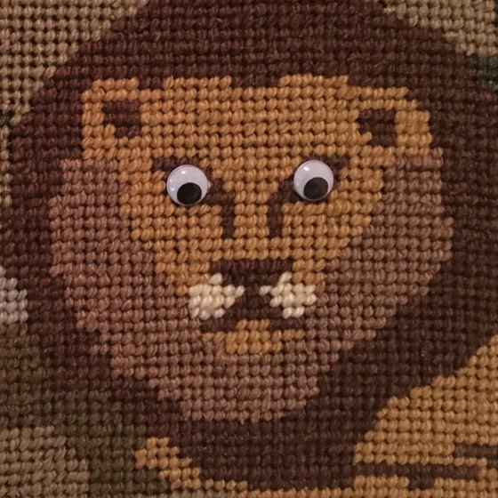

This file is a **draft**, so it never appears on the live site. It exists to show every
piece of formatting the site understands. To publish something real:

1. Copy this file inside `content/posts/` and give it a short name, like `minitel.md`.
   The file name becomes the address: `hueypriest.com/writing/minitel/`.
2. Fill in the block at the top. `title` and `date` are required. `dek` is the one-line
   summary under the headline. `tags` are optional topics.
3. Delete the `draft: true` line and commit.

## Formatting you can use

Plain paragraphs, *italics*, **bold**, and [links](https://hueypriest.com/about.html).
Quotes get a red rule:

> A community cookbook is a distributed, volunteer-run, user-generated content
> project with a moderation policy and a fundraising model.

Lists work the usual way:

- one thing
- another thing

Put images in `assets/img/` and reference them from the root. Always describe the
image in the square brackets, and put the source in italics on the next line:

*The lion. Source: a thrift store.*

## Three special blocks

**A clipping** is for archival scans. It needs an image and a `source`; `date`,
`page`, `link` and `note` are optional. The source also goes into the page's
hidden data, so search engines and AI tools can see what the piece rests on.

::: clipping

source: The Thrift Store Gazette
date: December 9, 1974
page: p. 1
link: https://hueypriest.com/about.html
note: A placeholder. Real clippings link to the scan.
:::

**A pull quote** sets one sentence large, to give a long piece a change of pace:

::: pullquote
People have been doing this work for a very long time. Most of them didn't call it that.
:::

**Wide** lets an image or table break out past the text column:

::: wide

*A wide image. Caption in italics on the next line.*
:::

---

## Sources go in footnotes

Cite as you go.[^dth] The notes collect at the bottom under "Sources & notes",
each with a link back to where it was cited.[^why]

[^dth]: Example citation: *The Daily Tar Heel*, December 9, 1974, p. 1. Link to the scan when one exists.
[^why]: Visible sources are the strongest trust signal a page can send, to people and to machines.

## If you change a published piece

Add `updated: 2026-12-01` to the top block. The page then shows both dates, and
search engines and AI tools see the newer one.
